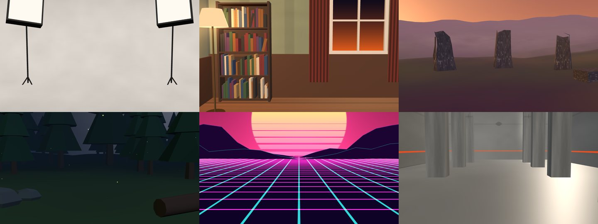

# VPUPPET

VPuppet is an open-source (MIT) webcam VTuber app. It loads a VRM avatar and drives it live from an ordinary webcam with Google MediaPipe: face (52 ARKit blendshapes, head pose, gaze), upper body and hands. It sends everything over the VMC protocol, and its spring-bone physics doesn't thrash. It is a desktop app for macOS, Windows and Linux, built with Tauri 2.


## Steam

The signed, auto-updating builds are sold on Steam ($19.99). There is a free demo: fully featured for 100 hours of use, after which tracking on the stage, the virtual camera and VMC lock (at the next launch, never mid-session); the model library still opens and keeps everything imported, and the full app picks up the same library. The demo is the cargo feature `demo` (`src-tauri/src/demo.rs`, `src/app/demo.ts`), built with `pnpm tauri:demo`; the source stays MIT. Store page copy, assets checklist and SteamPipe scripts are in [steam/](steam/README.md).

Renamed from Puppet: the first launch moves the old `com.spartangamestudios.puppet` config and data folders to the new identifier (`src-tauri/src/migrate.rs`). Environment variables keep their `PUPPET_` names and the test hooks stay on `window.__puppet`.

## Features

- **Face and perfect sync.** MediaPipe FaceLandmarker gives the 52 ARKit blendshapes and the head transform.
  - If the model has the ARKit-named expressions (a "perfect sync" model), each tracked value drives the expression of the same name, 1:1. Names match ignoring case and punctuation, so `eyeBlinkLeft`, `EyeBlinkLeft` and `eye_blink_left` all work.
  - Otherwise the VRM presets are derived from the blendshapes: `blink`, `blinkLeft`/`blinkRight`, `aa`/`ih`/`ou`/`ee`/`oh`, and `happy`/`angry`/`sad`/`surprised`/`relaxed` (the emotions have a dead zone and can be switched off).
  - Head rotation comes from the facial transformation matrix. Gaze from the `eyeLook*` blendshapes drives VRM lookAt (bone or expression type).
  - One-euro smoothing with a single SMOOTHING slider. Blinks and jaw keep a faster response at any setting.
  - **Calibrate** (`C`) captures your neutral face, head angle and gaze as zero. Until you do, the first steady second of an open-eyed, closed-mouth face is taken as neutral automatically (not saved), so an uncalibrated start doesn't carry MediaPipe's resting offsets (a few degrees of head pitch, a dark-lipped "pucker") onto the avatar.
  - Per-blendshape **gain** and **curve** (exponent) so mouths read strongly. You can edit them live next to the raw and output bars.
- **Upper body and hands.** PoseLandmarker world landmarks drive the spine, chest, shoulders and arms. HandLandmarker drives all finger bones. Choose FACE (`1`), +BODY (`2`) or +HANDS (`3`). Legs stay in an idle stance.
  - The solver is VPuppet's own: direction vectors against the model's measured rest directions.
    - **Arms:** the elbow is a true hinge (0–150°, never backwards); the plane it bends in sets the upper arm's twist, which is limited and held while the arm is too straight to show it. Part of the wrist twist moves into the forearm. The clavicles follow arm raises and shrugs.
    - **Depth:** MediaPipe's z is its noisiest axis, so forearm and shoulder-line depth is rebuilt from the 2D image and each bone's tracked length; z only decides the sign. The upper arm keeps MediaPipe's depth: it mostly hangs near the image plane, where any length error would tilt it forward.
    - **Torso:** lean and twist are solved and limited separately; the twist sits mostly in the upper chest.
    - **Occlusion:** each arm segment fades in and out with hysteresis, kept short (two frames to come in, three to go) so it doesn't add lag. An arm reaching out of frame keeps its upper arm, and an untracked limb eases to idle instead of snapping. A wrist MediaPipe places at the chin is not followed when the hand search looked there and found no hand of that side (a real hand at the face is never suppressed unseen).
    - **Fingers:** solved as anatomical angles (spread and bend at the knuckle, bend only at the middle and end joints), clamped to their ranges and smoothed per joint; the hand's orientation is smoothed the same way. The thumb's twist comes from the plane it bends in, so opposition reads.
  - **Hands** run in their own worker in parallel with the pose, and each result is applied as soon as it arrives rather than with the next pose. A full-frame HandLandmarker (two hands, MediaPipe's own palm detector) looks for both hands every frame, so a hand is found even where the pose has lost or misplaced its wrist (low in the frame, at the face, in front of the body). A hand it misses is followed by a crop of its own last landmarks, or looked for at the pose wrist. Each hand is given to the user's left or right by the pose wrists, the handedness label (weighted by how far it has proved right for this user), where it was last frame and which side of the nose it is on, and the pair is swapped back if those cues clearly disagree for a few frames. A crop never returns the other hand (it is painted out first).
  - **Gestures** (HANDS mode): fist, open palm, point, peace, thumbs up, OK and rock, per hand, shown in the debug overlay. They come from the hand landmarks (finger curls, thumb position) through hysteresis, so they don't flicker. Code can subscribe; see [Gesture events](#gesture-events).
  - Pose LITE/FULL switches live.
- **VMC protocol output** over OSC/UDP from the Rust side (`rosc`). Perfect-sync models also send the 13 VRM 0.x presets derived from the ARKit values, so preset-only receivers don't see a frozen face (see [VMC setup](#vmc-setup)). Messages: `/VMC/Ext/OK`, `/VMC/Ext/T`, `/VMC/Ext/Root/Pos`, `/VMC/Ext/Bone/Pos` (all humanoid bones, Unity coordinates), `/VMC/Ext/Blend/Val` and `/VMC/Ext/Blend/Apply`. Host and port are configurable (default `127.0.0.1:39539`). Bundles are split under 1200 bytes so they also cross a real network.
- **Virtual camera output.** VPuppet shows up as a webcam, **VPuppet Virtual Camera**, in Zoom, Meet, Discord, FaceTime and OBS (the camera card's **VIRTUAL CAM** section, `W`). It sends the capture view at 1280×720 or 1920×1080, 30 fps. Cameras have no alpha, so the CLEAR background is sent as the chosen colour (green by default); a 3D environment is sent as rendered, except depth of field, which is display-only. See [Virtual camera](#virtual-camera).
  - macOS 12.3+: a CoreMediaIO Camera Extension inside VPuppet.app (needs a Developer ID–signed build; see [docs/virtual-camera.md](docs/virtual-camera.md#macos-signing)).
  - Windows 10/11: a DirectShow camera built from [softcam](https://github.com/tshino/softcam) (MIT); one admin prompt to register it.
  - Linux: a v4l2loopback device you create with `modprobe`.
- **Cloth and hair physics.** A bone-cloth solver over the VRM's own spring bones (`src/physics/cloth/`):
  - neighbouring chains are found automatically (a skirt ring around the hips, a cape sheet, a hair fringe) and linked into a lattice, so panels move together instead of splaying into strands;
  - capsule colliders are generated from the humanoid skeleton and fitted to the skinned mesh (hips, legs, torso, arms, shoulders, neck, head), next to the model's own colliders;
  - whole segments collide (segment vs capsule, swept within each step), so a fast leg or arm can't tunnel through a joint;
  - authored stiffness, drag and gravity keep their VRM meaning; stiffness fades toward the hem of skirts and capes so they drape;
  - fixed-timestep (60 Hz × substeps), clamped speeds and smoothed torso input, as before.

  There is a global OFF / STIFF / NORMAL switch (`8` `9` `0`), the cloth groups (links on/off, stiffness, and per-chain grouping overrides), a per-chain table (on/off, stiffness/drag/gravity multipliers) and per-collider toggles, including the generated BODY colliders. Overrides are saved per model, keyed by the SHA-256 of the file. The previous solver (three-vrm's spring bones with stabilisers) stays available as SOLVER → LEGACY. See [Cloth benchmark](#cloth-benchmark) for measurements.
- **Animation clips (MOTION, `A`).** Idle loops, emotes and your own FBX / glTF clips, retargeted onto any VRM (0.x and 1.0) and layered over live tracking. See [Motion, hotkeys and lip sync](#motion-hotkeys-and-lip-sync).
- **Expression and emote hotkeys (HOTKEYS, `K`).** Keyboard, gamepad (first class) and, through an adapter, hand gestures; optional system-wide keys; an on-screen picker (`G` / pad RB).
- **Mic lip sync (LIP SYNC, `S`).** Off by default. Drives the mouth from your microphone when the face isn't tracked (FALLBACK), together with tracking (BLEND) or alone (AUDIO).
- **Model library (HOME).** The first screen at launch; `L` or `Esc` from the stage returns to it. See [Model library](#model-library).
- **App UX.**
  - Open a VRM from a file dialog (`O`) or by dropping it on the window; it is added to the library too.
  - The stage: the viewport gets the space. A narrow left column holds TRACKING and FRAMING; everything else is one click (or key) away:
    - **Top bar:** HOME, OPEN, then one button per settings window: **SCENE** (`B`, background + 3D environment), **FACE** (`F`, blendshape gains and curves), **PHYSICS** (`P`), **MOTION** (`A`), **HOTKEYS** (`K`), **LIP SYNC** (`S`), **VMC** (`N`). Each opens the same modal, docked right so the avatar stays in view; `Esc` / pad `B` closes it and focus returns to its button.
    - **Camera card** (bottom left): the preview with the landmark overlay, the SOURCE section (camera, resolution, tracking rate, mirror, restart) and the VIRTUAL CAM section. Minimize (`T`) collapses it to a strip; tracking keeps running.
    - **Bottom bar:** the model name (click or `I` for MODEL INFO and the licence) with a one-letter licence badge, a `!` for serious model-check warnings, the tracking state (TRACKING / LOST / FACE ONLY), the playing emote or held expression, PERFECT SYNC / PRESETS, outputs (VMC, VCAM) and the status line.
    - **Debug overlay** (`D`), top right of the viewport: render fps and frame time, face/body tracking fps, latency, inference time, gestures, **HANDS L/R** (each hand's search status: TRACKED, FOUND, MISS, SKIP, NO-ROI, OTHER-HAND, DUPLICATE, and the % of hand frames over the last 3 s it was found, plus BOTH), head and gaze. `?debuglog=1` logs the same with the status counts.
  - Licence letters: **A** AUTHOR ONLY · **L** LICENSED ONLY · **C** CC0 · **B** COMMERCIAL OK (business use) · **S** SOLO COMMERCIAL · **P** PERSONAL · **N** NO TERMS. AUTHOR ONLY and LICENSED ONLY show in the accent colour.
  - Controller first: `Tab` reaches every control; on a gamepad, `LT` enters menu mode on the stage (d-pad / stick move focus, `A` presses, left/right change sliders and drop-downs, `B` backs out). Modals and HOME take the pad on their own. Outside those the pad stays the performer's (emote and expression hotkeys).
  - Background: solid colour (chroma key presets), transparent, an image, or a lit **3D environment** (`E`, see below).
  - **Capture view** (`H`, `Esc` to leave) hides all UI for clean OBS capture.
  - Settings persist to `settings.json` in the app config dir.

### Keys

Stage: `L` / `Esc` home · `I` model info and licence · `O` open · `E` 3D environment on/off · `H` capture view · `Esc` leave capture view · `C` calibrate neutral · `M` mirror · `T` minimize / restore the camera card · `V` VMC on/off · `W` virtual camera on/off · `1` `2` `3` tracking mode · `8` `9` `0` physics off/stiff/normal · `R` settle physics · `B` scene · `F` face · `P` physics · `A` motion · `K` hotkeys · `S` lip sync · `N` VMC (each opens its window; the same key or `Esc` closes it) · `D` debug overlay · gamepad `LT` menu mode

Hotkeys (defaults, editable in HOTKEYS): `⌥1`–`⌥5` happy / angry / sad / relaxed / surprised · `⌥6` reset · `F3` wave · `F4` nod · `F5` shake · `F6` clap · `F7` cheer · `F8` bow · `F9` shrug · `F10` think · `G` picker. Gamepad (standard mapping): `A` wave · `B` nod · `X` clap · `Y` cheer · d-pad happy / surprised / sad / angry · `LB` shrug · `RB` picker · `BACK` reset. (Alt+digits because `1` `2` `3` are the tracking modes; F3 up because `F2` renames on HOME.)

Home: `←` `↑` `↓` `→` move · `Enter` load · `S` favourite · `L` licence · `F2` rename · `Del` remove · `/` search · `I` import · `Esc` back to the stage

## Motion, hotkeys and lip sync

### Clips (MOTION)

| clip | from | owns by default |
|---|---|---|
| IDLE: BREATHE / LOOK AROUND / TALKING / ARMS FOLDED | UAL `Idle_Loop`, `Idle_LookAround_Loop`, `Idle_Talking_Loop`, UAL2 `Idle_FoldArms_Loop` | idle (full body) |
| NOD (YES), SHAKE (NO) | UAL2 `Yes`, `Idle_No_Loop` | head |
| CHEER, ANGRY, CRY | UAL `Celebration`, `Counter_Angry`, `Crying` | body |
| DANCE, SIT (loop until triggered again) | UAL `Dance_Loop`, `Sitting_Idle_Loop` | full |
| DRINK | UAL `Drink` | arms |
| WAVE, CLAP, POINT | VPuppet (keyframed, `src/anim/authored.ts`) | arms |
| SHRUG, THINK | VPuppet | body |
| BOW | VPuppet | full |

UAL = the [Quaternius Universal Animation Library](https://quaternius.com) 1 and 2 (CC0 1.0). The library has no wave, clap, bow, point, shrug or thinking pose, so those six are VPuppet's own keyframes, authored against each avatar's measured rest directions. `scripts/build-builtin-clips.mjs` strips the UAL clips to bone tracks (no mesh, no skin, no scale tracks, rotations as normalized shorts, constant tracks as one key) into `public/clips/ual.glb`: 12 clips, 433 KiB.

- **Your clips.** IMPORT CLIP, or drop an `.fbx` / `.glb` on the window (a `.glb` without animations is still taken as a 3D environment). Mixamo (`mixamorig:` names), UAL / Unreal-mannequin and VRoid rigs are detected by bone names; common Blender/Unity names work as a fallback. VPuppet keeps a copy in `<appData>/clips/<sha256>/clip.fbx|glb` with a `clips.json` index (same rules as the model library). One entry per animation in the file; empty bind-pose takes are skipped. Mixamo's terms don't allow redistributing their files: import your own, never commit them.
- **Retargeting** (`src/anim/retarget.ts`): the clip is sampled at 30 fps and stored per bone as its world rotation change from the source's rest pose, in a frame detected from the rest pose (up = hips → head, left = right arm → left arm), so Y-up, Z-up and either facing all work. On binding to a model, each bone gets a fix rotation from the model's rest direction to the source's (an A-pose source keeps its A-pose arms on a T-pose VRM), and local rotations follow from the bones the model has (a missing upperChest folds into the chest). VRM 0.x models are handled by the same 180° turn VPuppet uses for tracking. Hips translation is scaled by hip height; travel is removed (in place), bob and sit height are kept.
- **Layering** (`src/anim/player.ts`): the IDLE clip plays while body tracking is off (FACE mode, unless switched off) or lost; with the face tracked the head stays the face's, with the face lost too the idle owns it. An emote plays over live tracking and owns the bones of its mask (FULL, BODY = all but neck and head, ARMS, HEAD), fading in over 0.3 s and out over 0.45 s; clips that move the hips (sit) fade over 0.8 s, because a fast drop pushes the legs through skirts faster than cloth collision follows. Face expressions stay tracked during every emote. Clips are applied as a slerp from the tracked pose, so a clip start is a continuous motion for the cloth solver.

### Hotkeys (HOTKEYS)

Each binding maps a trigger (key or combo, gamepad button, hand gesture) to an action: play an emote, set an expression (TOGGLE, ON, or HOLD while pressed; any VRM preset or custom expression on the model, with fades), RESET, or the PICKER. Click a trigger to rebind it. The dot marks a binding that belongs to the current model only (expressions differ per model); a model's own binding overrides a global one on the same trigger. Clashes with another binding or with an app shortcut are outlined.

- **GLOBAL** (off by default): the keyboard bindings are registered system-wide with `tauri-plugin-global-shortcut`, so they work while OBS or a game has focus. On macOS this uses Carbon hot keys (no Accessibility permission needed); verified with the desktop build running in the background (a synthesised `⌃⌥⇧F19` fired an emote). A registered key is taken from every other app while VPuppet runs, so prefer combos for global use; a combo another app owns fails to register, is listed, and still works in-window.
- **Gamepad** buttons work whenever the window can poll the Gamepad API (the app keeps rendering in the background).
- **Hand gestures** plug in through `GestureSource` (`src/input/gestures.ts`); the tracker's gesture events are the TODO adapter there.
- **Picker:** `G` or pad `RB` opens a grid of emotes and expressions over the stage. Arrows / d-pad / left stick move, `Enter` / `A` fires, `Esc` / `B` closes.

### Lip sync (LIP SYNC)

Pick the microphone and a mode: OFF, FALLBACK (audio drives the mouth only while the face isn't tracked, eased in and out), BLEND (the larger of tracked and audio, per shape) or AUDIO. The analysis (`src/audio/visemes.ts`) gates the frame level (GATE DB), estimates F1/F2 from a pre-emphasised, smoothed spectrum and matches them softly against the five vowels: preset models get `aa` `ih` `ou` `ee` `oh`, perfect-sync models `jawOpen`, `mouthFunnel`, `mouthPucker` and `mouthStretch`. Fast attack (30 ms), slower release (90 ms). The meter shows the level, the gate and each viseme.

The desktop app asks for the microphone only when you pick a mode: `NSMicrophoneUsageDescription` (Info.plist) and `com.apple.security.device.audio-input` (both entitlement files) cover the signed, notarized macOS build; the webview's request is granted from Rust on all platforms (WebKitGTK media streams are already enabled on Linux).

## Model library

HOME shows every imported model as a card: a bust thumbnail rendered at import, the name and author, VRM 0.x / 1.0, `PERFECT SYNC n/52` or `PRESETS n/13`, spring-bone chains, triangles, file size, a licence badge, a favourite star and when it was last used. Filter ALL / FAVOURITES (favourites always sort first in ALL), search by name or author, sort by last used, name or date added. Each card also has RENAME, RE-RENDER THUMBNAIL, MODEL DOCTOR, SHOW IN FOLDER and REMOVE FROM LIBRARY (asks first, and deletes only VPuppet's copy).

**MODEL DOCTOR** (`src/app/doctorUi.ts`, `src/vrm/`) fixes a model by editing only the VRM's glTF JSON (the binary chunk is written back byte for byte) and saves the result as a new library model or exports a `.vrm`: ARKit shapes spelled differently (`eyeBlink_L`, `blendShape1.jawOpen`) or present only as morph targets become the expressions perfect sync tracks (renamed, or new expressions bound to the morph on every mesh that has it), and the owner of a model can set its licence terms (CC0 / CC BY / personal / only me) in its own VRM version. AI agents get the same through the `model_doctor` MCP tool.

Import with **IMPORT .VRM** (`I`, several files at once) or by dropping `.vrm` files on HOME; each file shows its progress and its own error ("NOT A VRM ..."). Opening a model from the stage (`O`, drop) imports it as well. Models are deduplicated by SHA-256.

Storage (desktop):

```
<app data>/library/library.json          favourites, custom names, added / last-used times (atomic write)
<app data>/library/<sha256>/model.vrm    VPuppet's own copy, so moving the original is fine
<app data>/library/<sha256>/thumb.png    512×512 bust thumbnail
<app data>/library/<sha256>/meta.json    measured info and the parsed VRM meta (written last)
```

`<app data>` is e.g. `~/Library/Application Support/com.spartangamestudios.vpuppet` on macOS. `PUPPET_LIBRARY_DIR` (or `PUPPET_SETTINGS_DIR`, as `<dir>/library`) moves it for tests. The Rust commands (`src-tauri/src/library.rs`) only accept 64-hex-character ids and the three file names above, so nothing outside the library can be read, written or deleted through them. In a plain browser (`pnpm dev`) the library lives in IndexedDB instead. The pre-library "last model" setting is offered for import once.

### Licences

Every VRM carries its author's terms in its metadata. VPuppet reads them (VRM 1.0 and 0.x, `src/library/vrmMeta.ts`) and shows them in plain language in the card's LICENCE drawer and in the stage's MODEL INFO window (`I`, or click the model name in the bottom bar). The card badge summarises them: **AUTHOR ONLY** / **LICENSED ONLY** (only the author, or people they licensed, may perform as the model), **CC0**, **COMMERCIAL OK** (companies too), **SOLO COMMERCIAL** (individuals may earn money), **PERSONAL** (non-profit only) or **NO TERMS**. Loading an AUTHOR ONLY or LICENSED ONLY model shows a one-time notice. VPuppet never refuses to load a model: this is information, not DRM.

VRM 0.x fields map to 1.0 as the VRM consortium's migration does (`allowedUserName` → `avatarPermission`, `commercialUssageName` Allow → `personalProfit`); 0.x credit / redistribution / modification terms come from the licence name (CC0, CC_BY, ...) or a VRoid Hub licence URL. Literal `"undefined"` strings, which one exporter writes, count as empty.

`PUPPET_MODELS="a.vrm:b.vrm:c.vrm" PUPPET_URL=http://localhost:5173 node scripts/library-test.mjs out/` drives the whole library UI in headless Chrome (IndexedDB storage) and saves screenshots.

### 3D environments



Background **3D** (`E`) stands the avatar in a lit scene; the **SCENE** window (`B`) picks the scene and the look. All six built-in scenes are procedural (three.js geometry, shaders and canvas textures generated at runtime), so they add no asset files to the app.

| scene | what it is |
|---|---|
| STUDIO CYCLORAMA | seamless photo-studio cove, soft key/fill/rim, two softboxes framing the shot |
| COSY ROOM | wallpapered corner with a bookshelf, a window at dusk, a rug and a floor lamp that really lights the avatar |
| MOOR AT DUSK | rolling heather, a ring of standing stones, low sun, fog and drifting mist |
| NIGHT CLEARING | conifer ring under a starry sky, moonlight and GPU-animated fireflies |
| NEON GRID | scrolling synthwave grid, striped sun, glowing ridges |
| CONCRETE HALL | board-formed concrete, columns, light slots, a slot window and an orange rule |
| CUSTOM | your own `.glb`/`.gltf` (a `.gltf` may reference sibling `.bin`/texture files) and an equirectangular `.hdr`/`.exr` sky; drop the files on the window or use SCENE / SKY |

- **Placement (custom):** SCALE (log slider, 0.01–100×), POS X/Y/Z and ROTATE. A loaded scene is centred under the avatar with its lowest point on the floor. **FLOOR M** (every scene) moves the scene up or down so it meets the avatar's feet.
- **Light:** SCENE uses the scene's own key/fill/rim/ambient rig; KEY, RIM and SOFT restyle it. INTENSITY and TEMP K (white balance; 6500 is neutral) apply on top. The rig is held inside an exposure window measured on an MToon model (MToon wraps light far round the face, so even a back light lights it), so the face neither clips nor goes black at any setting. A custom HDR sky lights PBR materials through image-based lighting and MToon through a spherical-harmonics light probe, normalised to the rig's ambient level.
- **Atmosphere:** FOG (0.5 is the scene's default), GROUND SHADOW under the avatar.
- **Camera:** BUST/UPPER/FULL framing works as before; IDLE SWAY adds a slow ±1 cm drift; DEPTH OF FIELD (off by default, HIGH only) keeps the avatar sharp and blurs what lies behind it, reusing the colour pass's depth (no second scene render). It holds 60 fps at 1080p on an M3 Pro but costs MediaPipe about a quarter of its throughput, which is why it is off by default.
- **Quality:** LOW gives a soft blob shadow and no post-processing. HIGH adds a real, directional shadow map and allows depth of field. The avatar's shadow is cast by a dozen invisible capsules that follow its bones, not by its own meshes: re-skinning a detailed avatar (300k triangles) into a shadow map cost MediaPipe about 30% of its throughput, the capsules, refreshed at 20 Hz, cost nothing measurable. Glows (sun, fireflies, neon, lamps) are additive geometry rather than a bloom pass: a full-resolution HDR composer cost about 4 ms a frame at 1080p and halved MediaPipe's GPU throughput, so depth of field is the only post effect.
- Look settings are saved per scene (per file for custom scenes), placement per custom scene file, all in `settings.json`. The desktop app reopens the last custom scene and sky.

`node scripts/env-bench.mjs` measures each scene at LOW and HIGH against the flat background (see [Testing without a camera](#testing-without-a-camera)).

## Install, run, build

Requires Node 22+ and pnpm, Rust (stable), and the [Tauri 2 prerequisites](https://v2.tauri.app/start/prerequisites/) for your OS (Xcode command line tools on macOS; WebView2 on Windows; `libwebkit2gtk-4.1-dev` and friends on Linux).

```sh
pnpm install
pnpm tauri dev      # run the desktop app
pnpm tauri build    # release bundle: .app + .dmg on macOS, .msi/.exe on Windows, .deb/.rpm/.AppImage on Linux
pnpm test           # unit tests (blendshape mapping, one-euro filter, solver, VMC conversion, virtual camera frames, VRM meta / licences, library index)
cargo test --manifest-path src-tauri/Cargo.toml   # VMC OSC encoding, UDP loopback, virtual camera conversion and sinks, library path validation and storage
```

`pnpm dev` alone serves the UI in a normal browser at <http://localhost:5173>. Everything except VMC output (a browser can't send UDP) and native file paths works there.

**MediaPipe models are downloaded at build time, not vendored.** `scripts/fetch-models.mjs` runs before every `dev`/`build`. It downloads the four `.task` files (Apache-2.0, published by Google) from Google's official storage (`storage.googleapis.com/mediapipe-models/...`, versioned URLs) into `public/mediapipe/models/`, checks each one against a pinned SHA-256, and copies the tasks-vision WASM runtime out of `node_modules`. The release bundle contains them. The first build needs internet access.

Builds are unsigned unless the Apple signing secrets are configured (see [docs/virtual-camera.md](docs/virtual-camera.md#macos-signing)). On macOS, right-click the app and choose **Open** the first time, or run `xattr -dr com.apple.quarantine /Applications/VPuppet.app`.

Platform extras for the virtual camera: on macOS, `pnpm tauri build` also builds the Swift camera extension (`src-tauri/macos/build-camera-extension.sh`, needs Xcode); on Windows, `pnpm tauri dev` / `build` first build `softcam.dll` (`scripts/build-softcam.ps1`, needs git and Visual Studio 2022+ with C++, which Tauri needs anyway).

### Avatars

VPuppet ships no avatar. Use your own `.vrm` (VRM 0.x or 1.0), for example one exported from [VRoid Studio](https://vroid.com/en/studio), or any model whose licence allows your use. Check the model's own VRM licence metadata. `*.vrm` is git-ignored throughout this repo; please don't commit models.

## Virtual camera

1. Pick a background in **03 BACKGROUND** (CLEAR is sent as the chosen colour).
2. In the camera card's **VIRTUAL CAM** section, do the one-time setup the panel asks for:
   - **macOS:** VPuppet must be in /Applications. Click **INSTALL** on the EXTENSION line, then **OPEN SETTINGS** and approve it in System Settings → General → Login Items & Extensions → Camera Extensions (macOS 13–14: Privacy & Security → Allow). This needs a signed build; unsigned builds say so and point to the OBS route.
   - **Windows:** click **REGISTER CAMERA** and accept the admin prompt.
   - **Linux:** create a loopback device once (the panel shows this command, click to copy):
     ```sh
     sudo modprobe v4l2loopback devices=1 video_nr=10 card_label="VPuppet" exclusive_caps=1
     ```
3. Tick **SEND TO VIRTUAL CAMERA** (`W`) and pick **VPuppet Virtual Camera** (Linux: **VPuppet**) as the camera in Zoom, Meet, Discord or OBS.

Details, the Apple Developer portal setup for signed builds, and how it works: [docs/virtual-camera.md](docs/virtual-camera.md).

## OBS → Virtual Camera → Discord / Zoom (zero-install route)

This works on every OS without installing a camera driver. Use it when the native virtual camera isn't available (for example an unsigned macOS build).

1. In VPuppet, pick a background:
   - **COLOUR** green (`#00ff00`) is the most reliable;
   - **CLEAR** is transparent, but whether OBS keeps the alpha depends on the OS and capture method (see Known limitations).
2. Press `H` for **capture view**: only the avatar remains.
3. In OBS, add a **macOS Screen Capture** (method *Window Capture*) / **Window Capture** (Windows) / **Window Capture (Xcomposite)** (Linux) source and pick the VPUPPET window.
4. For a green background, right-click the source → **Filters** → **+ Chroma Key** (key colour Green).
5. Compose your scene, then click **Start Virtual Camera** in OBS.
6. In Discord (Settings → Voice & Video → Camera) or Zoom (Settings → Video → Camera), choose **OBS Virtual Camera**.

## VMC setup

1. In VPuppet's **VMC** window (`N`), set the receiver's host and port and tick **SEND VMC** (`V`).
   - The default `127.0.0.1:39539` is the usual VMC receive port (VSeeFace, Warudo, VNyan, VMC4U, and others).
   - For a receiver on another PC, use its LAN IP.
2. In the receiver, enable VMC/OSC receiving on that port.
   - Bones are sent as normalized-rig local rotations (identity in T-pose) in Unity coordinates, which is what receivers expect from a normalized VRM.
   - Blendshapes go out under the model's own expression names. Presets use the VRM 0.x clip names (`Blink`, `Blink_L`, `A`, `I`, `U`, `E`, `O`, `Joy`, `Angry`, `Sorrow`, `Fun`, `Surprised`), and perfect-sync models send the ARKit names. In VSeeFace, enable perfect sync on the receiving model to use them.
   - ALSO SEND VRM PRESETS (on by default) adds `Blink`, `Blink_L`, `Blink_R`, `A`, `I`, `U`, `E`, `O`, `Joy`, `Angry`, `Sorrow`, `Fun`, `Surprised` to every frame: derived from the ARKit values with the same mapping preset models use (blink from `eyeBlink*`, vowels from jaw and mouth shapes, `Joy` from the smile...), combined with the model's own preset values when it drives them. The ARKit values are still sent. `src/vmc/presets.ts`.

The TX readout shows frames and bytes sent. "Nothing listening" errors are counted, not fatal.

## VMC input (body trackers, phone apps)

VPuppet also receives VMC (`src-tauri/src/vmc_in.rs`, `src/vmc/vmcInput.ts`, VMC window → VMC IN): SlimeVR, mocopi, iPhone face apps or any VMC sender drive the body regions you pick (FACE, HEAD, TORSO, ARMS, FINGERS, LEGS; default TORSO + LEGS from VMC, the rest from the webcam). A Rust thread listens on UDP (default 39539, localhost only unless ALLOW OTHER DEVICES is ticked), decodes `/VMC/Ext/Bone/Pos`, `/VMC/Ext/Root/Pos`, `/VMC/Ext/Blend/Val` + `Apply`, and the webview polls the latest pose once per frame. Bone rotations are normalized-rig local rotations (identity at T-pose), the same convention as VPuppet's output; they are written after idle and emote clips, and hand back over 0.3 s when the sender stops for 0.5 s. Blend shapes match by ARKit name, VRM 0.x clip name or the model's own names. Hips position isn't applied yet (rotations only), so a seated pose keeps the hips at standing height.

Test without hardware: `node scripts/vmc-send.mjs <sit|walk|squat|lean|face|all> [port] [seconds]` sends a scripted motion.

## AI agents (MCP server)

VPuppet can host a local [MCP](https://modelcontextprotocol.io) server so AI agents on your computer (Claude Code, Claude Desktop, Cursor and other MCP clients) can look at and drive the running app: inspect a model while you build it in Blender, check its perfect-sync shapes, take screenshots, try expressions and clips, and read tracking stats and errors.

1. In the **VMC** window (`N`), tick **ALLOW AI AGENTS (LOCAL MCP SERVER)**. It is off by default.
2. Register VPuppet with your clients (run it again after **NEW TOKEN** or a port change):
   ```sh
   # macOS / Linux
   curl -fsSL https://raw.githubusercontent.com/Spartan-Game-Studios/puppet/main/apps/docs/public/mcp/install.sh | sh
   # Windows (PowerShell)
   irm https://raw.githubusercontent.com/Spartan-Game-Studios/puppet/main/apps/docs/public/mcp/install.ps1 | iex
   ```
   The script reads the token from VPuppet's config folder and adds a `vpuppet` server to Claude Code (`claude mcp add --transport http --scope user`), Cursor (`~/.cursor/mcp.json`) and Claude Desktop (`claude_desktop_config.json`, through the [`mcp-remote`](https://www.npmjs.com/package/mcp-remote) bridge, which needs Node.js). It merges JSON configs, backs them up first, never prints the token, and is safe to re-run. `| sh -s -- --uninstall` (or `$env:VPUPPET_MCP_UNINSTALL=1` on Windows) removes the entries. Other clients: an HTTP (Streamable HTTP) MCP server at `http://127.0.0.1:39540/mcp` with the header `Authorization: Bearer <contents of mcp-token>`; **COPY CLAUDE CODE COMMAND** in the app copies a ready `claude mcp add` line.

Security: the server listens on `127.0.0.1` only, every request needs the bearer token (random, created on first enable, kept as `mcp-token` next to `settings.json`, owner-only on macOS/Linux), and requests with a browser `Origin` header or a non-loopback `Host` are refused, so web pages cannot reach it. It reads only files you or the agent name (`library_import`). The port (default 39540) is set next to the toggle; `mcp.json` beside the token records it for the installer.

| Tool | What it does |
| --- | --- |
| `app_status` | Version, demo state, model on the stage, screen, tracking mode/state, outputs, fps |
| `library_list` / `library_load` / `library_import` | List the library; load by id (refused once the Steam demo has ended); import an absolute `.vrm` path (and load it) |
| `model_inspect` | VRM version and meta, humanoid bones mapped/missing, every expression and its binds, ARKit perfect-sync coverage (missing names, and ones present under another naming such as `eyeBlink_L`), presets, look-at, spring chains/colliders, mesh/material/texture stats, licence, model-check warnings |
| `stage_screenshot` | PNG of the stage as you see it, or framed face / bust / upper / full |
| `expression_set` / `expression_sweep` | Hold an expression over tracking; drive each expression in turn with the pose frozen and report dead shapes and swapped Left/Right, with a contact sheet |
| `clip_list` / `clip_play` | Built-in and imported animation clips |
| `tracking_stats` / `logs_recent` | Per-pipeline fps/latency, hand search per side; recent status lines and errors |
| `settings_get` / `settings_set` | Tracking mode, smoothing, framing, background, physics mode (nothing else) |

A typical loop: `model_inspect` → fix the model in Blender → export → `library_import` the new file → `expression_sweep set=arkit` to verify perfect sync. Code: `src-tauri/src/mcp/` (server on the official Rust SDK [`rmcp`](https://crates.io/crates/rmcp), auth, tool list in `tools.json`) and `src/app/mcpBridge.ts` (the tools, run in the webview).

## Perfect sync, explained

ARKit (iPhone face tracking) defines 52 named blendshapes such as `eyeBlinkLeft`, `jawOpen` and `mouthSmileLeft`. A **perfect-sync** model ships one expression per ARKit name, sculpted by the modeller. The tracker's 52 numbers then drive the face directly, and every mouth and brow shape reads as the artist intended instead of being squeezed into five vowels and a blink. MediaPipe's FaceLandmarker outputs the same 52 names (minus `tongueOut`), so a webcam can drive a perfect-sync model without an iPhone.

VPuppet detects perfect sync when the model has at least 40 of the 52 names. The bottom bar shows `PERFECT SYNC n/52` or `PRESETS n/13`. Rows the model lacks are struck through in the FACE window (`F`).

## Testing without a camera

The app accepts URL parameters in the browser and, for the desktop app, the same parameters through the `PUPPET_QUERY` environment variable:

| parameter | effect |
|---|---|
| `source=file&src=<video>` | feed a recorded clip instead of the camera (`loop=0` to play once) |
| `model=<url or path>` | load a VRM at start |
| `mode=face\|upper\|hands`, `mirror=0\|1`, `vmc=0\|1` | override settings |
| `tracker=main` | run MediaPipe on the main thread instead of workers |
| `record=1` | keep a per-result log in `window.__puppet.record` |
| `debuglog=1` | print a stats line every 2 s (stdout in the desktop app) |
| `vcam=1`, `vcamres=1280x720\|1920x1080`, `vcamsend=0` | start the virtual camera output; `vcamsend=0` grabs frames without sending them |

Desktop-only environment variables: `PUPPET_VCAM_SINK=file:/abs/out.yuyv` (write virtual camera frames to a file plus a JSON summary instead of the OS camera) or `=null`, `PUPPET_VCAM_SELFTEST=status|setup`, and `PUPPET_SETTINGS_DIR` (use a scratch settings folder). See [docs/virtual-camera.md](docs/virtual-camera.md#testing-without-a-camera).

For example:

```sh
PUPPET_QUERY="source=file&src=/abs/clip.mp4&model=/abs/avatar.vrm&debuglog=1" pnpm tauri dev
```

The scripts in `scripts/` drive headless Chrome through Playwright, using your installed Google Chrome. Local assets are served by request interception, so they never need to be inside the repo.

- `PUPPET_MODEL=avatar.vrm node scripts/render-clip.mjs out/` renders test footage from a VRM, with frame-exact ground truth (`truth.json`). It is a scripted performance shot by a webcam-like camera (49 s):
  - face, 0–14 s: jaw, blinks, a wink, smile, pucker, brows, head turns, arm raises;
  - body, 14.6–49 s: the seven gestures held 0.9 s each with transitions (each hand runs its own order), slow finger curls, crossed arms, hands at the face, torso lean and twist, an arm leaving the frame, a T-pose and an arms-out-forearms-up pose.
  - The truth includes each arm bone's direction and every finger joint's bend, measured from the posed model, the held gesture per hand, and whether each hand is in frame. `PUPPET_CLEAN=1` paints out heavy face makeup, which MediaPipe misreads (black lipstick reads as a pucker). `node scripts/render-frames.mjs out/ 16.2 30` renders single moments for a quick look.
- `PUPPET_MODEL=avatar.vrm node scripts/track-clip.mjs out/ shots/` plays that clip through the real app pipeline (`?source=file`). It reports detection rates, fps, latency and the correlation of each face channel with the truth; for the body section, per segment: hand detection rate, finger-joint error, upper-arm and forearm direction error and elbow error, plus gesture accuracy with a confusion matrix, gesture flicker, jitter at rest, end-to-end lag and peak arm speed. It then screenshots key moments; `PUPPET_VIDEO=1` also records `shots/mirror.mp4`.
- `PUPPET_RAW=raw.json` with `track-clip.mjs` also saves the raw body and hand results as they reached the main thread; `PUPPET_MODEL=avatar.vrm node scripts/track-replay.mjs out/ raw.json ['{"handsOnArrival":false}' ...]` replays them through the app's body path (hands merge, pose filter, solver, bone follow) in virtual time and reports the body metrics. The input is identical on every replay, so pipeline changes can be compared without the run-to-run noise of playing the clip; each JSON argument is a variant (`harness/replay.ts`, `ReplayOptions`).
- `node scripts/track-seq.mjs out/` runs the pose and hand models over the clip's frames on the main thread, frame by frame, and prints hand detection per segment (left, right, both, wrong-side hands, search status counts): quicker and more repeatable than playing the video. `PUPPET_HANDS='full=off'` (or `full=search`) compares hand search variants (`HandSearchOptions`).
- `PUPPET_SCRIPT=webcam PUPPET_CAM=desk` with `render-clip.mjs` renders the **webcam clip** instead (48 s): what a real desk webcam sees and the default clip doesn't. Hands at the face (a cheek, both cheeks, over the mouth, chin on a fist, open palm in front of the face, beside the head), both hands up through a whole gesture run, hands low at the bottom edge, close to the camera, in front of the body and together, shot by a closer desk camera that cuts off at the chest. `track-clip.mjs` reports `handSearch` (found % per side and both-found where both hands are in view, wrong-side hands, status counts and hands-worker ms per segment, with a FACE total) and `faceStability` (head error and the largest head and jaw jumps per segment); `PUPPET_MIRROR=1` plays it mirrored.
- `PUPPET_MODEL=avatar.vrm node scripts/physics-test.mjs` runs the physics stability test below.
- `PUPPET_MODEL=avatar.vrm node scripts/cloth-test.mjs [out.json]` runs the [cloth benchmark](#cloth-benchmark); `VIDEO=dir` also renders side-by-side videos.
- `PUPPET_MODEL=avatar.vrm node scripts/record-pose.mjs clip-dir/ pose.json` records a real tracking session (the clip played through the app) as bone rotations, for the benchmark's `recorded` scenario (`PUPPET_POSE=pose.json`).
- `PUPPET_MODELS=a.vrm,b.vrm [PUPPET_FBX=clip.fbx] node scripts/anim-test.mjs out/` plays every clip (and an imported FBX / GLB) on each avatar with the real animation layer and physics, in virtual time on its own Vite server (port 5211). It writes a contact sheet per avatar and an mp4 per clip (front and side), and reports the largest frame-to-frame limb jump, the peak cloth / hair speed relative to the hips, and how far the avatars' limb directions differ for the same clip (a VRM 0.x and a VRM 1.0 should move alike).
- `PUPPET_MODEL=avatar.vrm [PUPPET_LIPSYNC_MODE=fallback|blend|audio] node scripts/lipsync-test.mjs` generates a WAV of five synthetic vowels, feeds it to Chrome as a fake microphone, and checks which viseme the analysis picked for each vowel and that the mouth closes in the gaps.
- `node scripts/vmc-listen.mjs 39539 5 blends` also lists every blend shape name received, with its peak value.
- `PUPPET_MODEL=avatar.vrm node scripts/screenshot.mjs ui.png` screenshots the UI.
- `PUPPET_MODEL=avatar.vrm node scripts/vcam-test.mjs out/` checks the virtual camera frame source in headless Chrome (size, BGRA order, background composite, 30 fps), and `scripts/vcam-desktop-test.mjs` runs a built desktop app with the file sink and measures CPU with the output on and off.
- `PUPPET_MODEL=avatar.vrm PUPPET_CLIP=clip.webm node scripts/env-bench.mjs out/` benchmarks the 3D environments in capture view at 1920×1080: render fps, frame time, tracking fps and inference time, and the avatar's face brightness, for every scene at LOW and HIGH against the flat background. It saves a screenshot of each scene. `PUPPET_UNCAPPED=1` removes vsync to show headroom.

Footage rendered from a model inherits that model's licence. Keep it out of the repo unless the model is redistributable.

### Physics stability test

`harness/physics.ts` loads a VRM and runs a scripted sway and shake of the root for 6 s, followed by 6 s of stillness, in virtual time:

- sway: ±8 cm and ±14° at 0.6 Hz, plus 3 Hz shake;
- 30 Hz tracking-style jitter of ±6 mm and ±1.5°;
- frame time of 60 fps ±2 ms, with a 60–120 ms hitch every 0.9–1.7 s.

It measures spring-tail speed **relative to the hips** (the motion that reads as cloth or hair thrash) and the settle time until every joint stays under 0.05 m/s.

Results on a VRM 1.0 avatar with a 20-chain skirt (120 skirt joints, 223 joints in 41 chains, leg/torso colliders), 3 seeds, worst case:

| condition | max speed, all joints | p99, all | max speed, skirt | p99, skirt | settle time |
|---|---|---|---|---|---|
| three-vrm `update(frameDelta)`, raw root (no stabilisers) | 15.4 m/s | 9.8 | 7.5 | 3.6 | never (buzzes at 0.02–0.03 m/s from frame-time jitter until the end, 5.6–6.0 s) |
| fixed step + substeps only | 9.0 | 5.6 | 4.4 | 3.4 | 0.87 s |
| + speed clamp + collision damping | 7.4 | 5.4 | 4.4 | 3.3 | 0.97 s |
| **all stabilisers** (+ root smoothing, inertia 0.6) | **5.3** | **3.5** | **1.7** | **1.5** | **0.81 s** |

### Cloth benchmark

`harness/cloth.ts` (`scripts/cloth-test.mjs`) drives a VRM through scripted motion in virtual time and measures what makes spring cloth look bad:

- **scenarios:** `shake` (the stability test's root sway, jitter and hitches), `lean` (hips ±25° yaw, ±15° roll, 25° forward bend, then a quick twist, over planted legs), `head` (turns, nods, tilts and a fast shake), `arms` (raised high, swung, flicked and dropped), `hitch` (15–25° torso snaps in one frame and 150–300 ms stalls), and `recorded` (a real tracking session from `scripts/record-pose.mjs`);
- **clipping:** cloth segments, and mesh vertices skinned to cloth, inside the body (the inner part of the generated body capsules), beyond whatever overlaps in the rest pose; hair segments the same way; arms reported separately. "Sim-only" leaves out root segments whose animated head is itself inside the body (physics can't move a head). `JOINTS=1` lists offenders per joint (`chain[k]`, 0 = root segment), and the log lists the cloth meshes whose vertices clip, per body part. `CORES=legacy` measures against the body fit as it was before the inner-shell change below, for comparing with older runs;
- **shape:** how far neighbouring cloth chains drift from their rest spacing (splaying apart or bunching into a tube);
- tail speed relative to the hips, settle time, jitter at rest, and the CPU time of the physics update.

Results on a VRM 1.0 avatar (223 joints in 41 chains: a 20-chain floor-length skirt, 14 hair strands, 4 braids, 3 sleeve ribbons; 427 bones), two seeds, Chrome on an M3 Pro. "before" is `main` (legacy solver, and the skin-index overflow described below); "after" is the cloth solver.

| scenario | skirt segments in the body (% of frames, max depth) | cloth vertices in the body (mean %) | hair in the body (% of frames, max depth) | neighbour spacing error (p95) | settle | physics ms/frame (mean / p99) |
|---|---|---|---|---|---|---|
| lean, before | 50.5%, 99 mm | 1.66% | 24.2%, 31 mm | 1118% | 0.54 s | 0.43 / 1.0 |
| lean, after | 14.5%, 26 mm | 0.68% | 0%, 0 mm | 39% | 0.67 s | 0.55 / 0.9 |
| head, before | 20.0%, 5 mm | 1.65% | 41.3%, 37 mm | 110% | 0.75 s | 0.41 / 0.9 |
| head, after | 0% | 0.49% | 0% | 11% | 0.30 s | 0.54 / 0.9 |
| hitch, before | 40.9%, 53 mm | 1.09% | 14.5%, 48 mm | 335% | 0.90 s | 0.43 / 1.4 |
| hitch, after | 18.1%, 15 mm | 0.96% | 0.4%, 10 mm | 33% | 0.96 s | 0.56 / 1.9 |
| recorded, before | 5.1%, 11 mm | 1.71% | 91.4%, 36 mm | 110% | 0.48 s | 0.40 / 0.6 |
| recorded, after | 0% | 0.49% | 0.5%, 0.3 mm | 11% | 0.32 s | 0.55 / 0.9 |

#### Leaning and hitches

Three changes, measured on the same avatar against the corrected body fit (two seeds; "before" is the cloth solver as it was):

- **Inner-shell leg fit** (`innerShell` in `bodyColliders.ts`). The leg capsules were fitted to every non-spring vertex the leg bones carry, and a floor-length cape skinned to the legs inflated them: shins 18 cm instead of 6 cm, one thigh 15 cm and the other 9 cm. That made the collisions lopsided, and the benchmark's "inside the body" core for the shins 18 cm wide, so it counted skirt 15 cm off the leg as clipping. The legs are now fitted to their innermost mesh only.
- **Root push** (`pushRoots` in `rig.ts`). Most of what was left was skirt roots: they are pinned to the hips, so when the hips turn, roll or bend over planted legs, the front and side roots move into the thighs, and only the segments below a root are simulated. Each skirt root is now moved out of the leg capsules it clears at rest, by at most 3 cm, and the bone moves with it.
- **Sheet contacts** (`collideLinks` in `solver.ts`). The links between neighbouring skirt and cape chains collide too, so two chains either side of a shin can't leave the mesh between them cutting through it.

| scenario | skirt segments in the body (% of frames, max depth) | sim-only | cloth vertices in the body (mean / max %) | neighbour spacing error (p95) | max cloth speed | settle | physics ms/frame (mean / p99) |
|---|---|---|---|---|---|---|---|
| shake | 0% → 0% | 0 → 0 | 0.16 / 0.90 → 0.18 / 0.94 | 24% → 42% | 3.9 → 5.1 m/s | 0.86 → 0.76 s | 0.56 / 1.4 → 0.55 / 1.5 |
| lean | 21.3%, 13 mm → **0%** | 0.6%, 2 mm → 0 | 0.28 / 1.32 → 0.30 / 1.39 | 39% → 38% | 2.5 → 1.6 m/s | 0.67 → 0.50 s | 0.52 / 0.8 → 0.54 / 0.9 |
| head | 0% → 0% | 0 → 0 | 0 → 0 | 11% → 11% | 0.7 → 2.7 m/s | 0.30 → 0.30 s | 0.53 / 0.9 → 0.55 / 0.9 |
| arms | 0% → 0% | 0 → 0 | 0 / 0 → 0.05 / 0.10 | 11% → 11% | 13.8 → 9.7 m/s | 0.38 → 0.38 s | 0.57 / 1.1 → 0.62 / 1.2 |
| hitch | 35.2%, 10 mm → **0%** | 0 → 0 | 0.32 / 1.49 → 0.38 / 2.32 | 33% → 38% | 18.2 → 16.4 m/s | 1.21 → 2.15 s | 0.61 / 2.3 → 0.58 / 1.9 |
| recorded | 0% → 0% | 0 → 0 | 0 / 0 → 0.02 / 0.10 | 11% → 11% | 9.5 → 8.7 m/s | 0.32 → 0.22 s | 0.53 / 0.9 → 0.55 / 1.0 |

The hitch settle time is set by the shoulder ribbons, not the skirt. Most of the remaining cloth vertices in the legs belong to a gown panel that is skinned about half to the pelvis, down to the shins: it swings with the hips whatever the springs do, and only a re-export with those weights on the skirt bones would fix it. Against the old fit (`CORES=legacy`) lean and hitch read worse (32% and 28% of frames), all of it skirt within the old 18 cm shin core. The stiff-skirt variant: lean 20.9%, 52 mm → 0% and hitch 35.2% → 0%, cloth vertices 0.68 → 0.56% and 0.93 → 0.79%. The VRM 0.x model with a 10-chain skirt ring: unchanged (0–0.5% of frames, under 7 mm), 0.13 → 0.16 ms.

On the same avatar the stability test above gives, for the cloth solver: 1.44 m/s max tail speed (p99 1.36, skirt median 0.53) and 0.29 s settle time.

**Skin-index overflow.** `VRMUtils.combineSkeletons` (three-vrm 3.5.5) remaps each mesh's joint indices into one combined skeleton but keeps the attribute's array type. With 8-bit `JOINTS_0` and more than 256 bones in total, indices wrap around: on the avatar above a third of the gown's vertex weights pointed at hair spring bones, so the skirt tore apart whenever the hair moved, whatever the physics. VPuppet now widens skin indices to 16 bits before combining (`widenSkinIndices` in `src/scene/avatar.ts`).

## Gesture events

`GestureTracker` (`src/core/gestures.ts`) is the app's gesture source, at `window.__puppet.gestures` (and the `gestures` object in `main.ts`):

```ts
const off = gestures.on((e) => {
  // e.hand: 'left' | 'right'          the user's hand
  // e.avatarHand: 'left' | 'right'    the avatar hand it drives (swapped when mirrored)
  // e.gesture / e.previous: 'none' | 'fist' | 'open' | 'point' | 'peace' | 'thumbsUp' | 'ok' | 'rock'
  // e.confidence: 0..1;  e.t: tracker time, ms
});
gestures.current.right; // the right hand's gesture now
off();                  // unsubscribe
```

An event fires on every change, including back to `none` (a gesture let go, or the hand lost for 300 ms). A gesture is reported after it has won for 150 ms and dropped after it has scored under 0.3 for 200 ms. Gestures need HANDS mode. The HOTKEYS gesture triggers (e.g. thumbs up → an emote) are fed from these events through `trackerGestureSource` (`src/input/gestures.ts`), with the names `fist`, `open_palm`, `point`, `peace`, `thumbs_up`, `ok` and `horns`, per user hand.

## Tracking quality

Measured with `scripts/track-clip.mjs` on the rendered test clip (49 s, 640×480, played unmirrored in HANDS mode, headless Chrome on an M3 Pro), before → after the tracking-quality work, on three models. Errors are mean angles against the posed model's own bones; a hand counts as found only while it is in view. Repeated runs vary by a few points.

| metric | realistic VRM 0.x | anime VRM 0.x | VRM 1.0, caped |
|---|---|---|---|
| hand found, all frames with a hand in view (%) | 61.9 → 86.2 | 33.4 → 65 | 9.9 → 57.2 |
| hand found, gestures section (%) | 99.7 → 98.6 | 36 → 84.2 | 10.1 → 77.4 |
| hand found, crossed arms (%) | 7.3 → 51.4 | 11 → 45.1 | 0 → 16 |
| gesture accuracy (%) | 0 → 98 | 0 → 83.1 | 0 → 86.1 |
| finger joint error (°) | 17.4 → 15.1 | 22.7 → 20.2 | 26.8 → 18.8 |
| upper arm direction error (°) | 15.4 → 18.6 | 18 → 19.1 | 20.9 → 22.3 |
| forearm direction error (°) | 39.6 → 36.3 | 36.2 → 30.3 | 45.8 → 41.4 |
| forearm error, lean and twist (°) | 55 → 55.7 | 54.4 → 42.7 | 67.8 → 54.4 |
| forearm error, arm leaving frame (°) | 55.1 → 48.3 | 67.6 → 57.5 | 110.8 → 91.5 |
| forearm error, 90° abduction (°) | 43 → 35.8 | 59.2 → 46.9 | 61 → 53.5 |
| elbow bend error (°) | 21.2 → 19.5 | 22 → 18.2 | 25.3 → 23.8 |
| jitter at rest, arms (°, RMS 2nd diff) | 0.69 → 1.34 | 1.41 → 2.06 | 2.7 → 1.65 |
| jitter at rest, fingers (°) | 1.63 → 1.16 | 4.16 → 1.83 | 1.35 → 1.17 |
| end-to-end lag (ms) | 100 → 140 | 140 → 160 | 200 → 320 |
| body fps | 24.3 → 30.6 | 25.6 → 30.6 | 30.5 → 30.5 |
| face fps | 30.6 → 30.4 | 30.5 → 30.5 | 30.5 → 30.5 |
| hands fps (own worker after) | (in body) → 28.9 | (in body) → 25.4 | (in body) → 25.9 |

- Gestures: on the realistic model every gesture was recognised (the misses are thumbs up read as a fist for 2 frames and 10 frames of `none` read as a fist). On the other two, most misses are the hand not being found at all, which reads as `none`.
- Arm jitter at rest went up on two models: arm depth now comes from the 2D image points, which carry their own noise.
- The arm-leaving-the-frame and T-pose segments are hard on the rendered footage: MediaPipe's pose model loses or misplaces an arm stretched out of view, and on the caped model it places the elbow inside the cape.
- Rendered footage is not a webcam: anime hands, gloves and capes are harder for MediaPipe than real hands. Real webcam footage was not available.

### Tracking lag

The `end-to-end lag` row is the time shift that best lines up the tracked signal (both elbow bends plus the finger joints' sum / 10) with the truth, so it covers body and hands; the elbows carry most of it. The tracking-quality work above raised it. Measured stage by stage with `scripts/track-replay.mjs` (same captured input every time), what it added and what changed:

- **Limb gates:** an arm waited 0.12 s for confidence, then faded in over 0.25 s, on every re-entry. Now two frames in, three out, with short fades.
- **Upper-arm depth from bone length:** a hanging upper arm projects at nearly its full length, so a slightly long length estimate tilted it forward: upper-arm error, rest jitter, and elbow-signal error that read as lag. Only the forearm and shoulder line are rebuilt now.
- **Hands waiting for the next pose:** the hands worker finishes after the pose (about 25 vs 13 ms), so hands were 38–56 ms old when applied; applied on arrival, 23–34 ms.
- **Bone follow:** arms, hands and fingers eased toward their targets at 16/s (about 60 ms). They now follow at 32/s at the default SMOOTHING (16/s at full SMOOTHING), and the hand's orientation is one-euro filtered like the fingers.
- The pose one-euro filter and finger smoothing added little; worker scheduling adds 13–22 ms (pose) and 24–35 ms (hands) from frame grab to the main thread. Nothing else buffers a frame.

Replayed through the body path, 13 captures per model, before → after (hand detection is unchanged by construction):

| metric | realistic VRM 0.x | anime VRM 0.x | VRM 1.0, caped |
|---|---|---|---|
| end-to-end lag (ms) | 200 → 120 | 237 → 149 | 332 → 163 |
| upper arm direction error (°) | 18.1 → 15.9 | 18.4 → 16.6 | 22 → 21.4 |
| forearm direction error (°) | 35.8 → 34.8 | 30.1 → 29.2 | 41.1 → 41 |
| forearm error, lean and twist (°) | 55.6 → 57.3 | 42.1 → 45.9 | 53.6 → 59.1 |
| forearm error, arm leaving frame (°) | 48.2 → 51.8 | 55.9 → 61.6 | 91.9 → 94.3 |
| forearm error, 90° abduction (°) | 34.9 → 29.3 | 48.5 → 37.2 | 49 → 41.6 |
| finger joint error (°) | 16.9 → 16.2 | 22.4 → 22.3 | 20.3 → 19.4 |
| gesture accuracy (%) | 89.7 → 90.6 | 74.4 → 74.5 | 78.8 → 79.9 |
| jitter at rest, arms (°) | 1.9 → 2.4 | 2.9 → 4.5 | 2.6 → 3.6 |
| jitter at rest, fingers (°) | 1.6 → 2.8 | 2.4 → 4.5 | 1.5 → 2.5 |

The captures span a loaded and a quiet machine; on the three quiet ones (hands at 27–29 fps, as in the table above) the lag is 100 / 127 / 180 ms. The extra rest jitter is the price of the faster follow. SMOOTHING at 1 (on the same quiet captures) gives less jitter than before this change (arms 1.4 / 2.1 / 1.8°, fingers 1.0 / 1.9 / 1.4°) at about the old lag (173 / 187 / 213 ms).

### Compatibility sweep

`scripts/compat-sweep.mjs` (`harness/compat.ts`) loads each VRM with the app's own loader in headless Chrome on its own Vite server (port 5233) and checks what tends to break from model to model: load errors and warnings, VRM version and licence, humanoid bones VPuppet needs, rest pose (T / A) and facing, bounds and the BUST / UPPER / FULL framing (camera outside the mesh, avatar in view), whether expressions and gaze visibly change the picture, spring chains and cloth groups under a shake (max speed, settle time, NaN), skinned bone count (over 256 takes the 16-bit skin-index path), materials (MToon, transparency, outlines, black or pink or missing textures), render fps at 1280×720, the IDLE / WAVE / CHEER clips (frame-to-frame limb jumps), and the library's import analysis and thumbnail. With `PUPPET_CLIP_DIR` set to a rendered test clip (`scripts/render-clip.mjs`) it also plays the clip through the real app per model, screenshots rest / head turn / arms up and checks the arms go up and the head turns the mirrored way, opens MODEL INFO and the library card. It writes `report.html` (one row per model, PASS / WARN / FAIL per check, thumbnails and screenshots) and `report.json`.

```sh
node scripts/fetch-test-avatars.mjs             # the CC0 test avatars (pinned URLs + SHA-256) into test-assets/cc0/
node scripts/compat-sweep.mjs out/              # every .vrm in test-assets/cc0/
PUPPET_CLIP_DIR=clip/ node scripts/compat-sweep.mjs out/ a.vrm b.vrm   # your own models, plus the tracking-clip pass
```

CI runs it on the two committed fixtures (`test-assets/cc0/devil.vrm`, `the-worm.vrm`; CC0, see `LICENSES.md` there) with software GL and fails on any FAIL. Reports made from your own models show those models: keep them out of the repo.

**Model checks.** On load VPuppet looks for authoring problems it can detect cheaply and reliably (`src/scene/modelChecks.ts`) and lists them under MODEL CHECKS in MODEL INFO; the serious ones also go on the library card: FACE POINTS AWAY FROM SKELETON (the face mesh is on the back of the head bone), MODEL FACES AWAY FROM THE CAMERA, MISSING BONES, FACE EXPRESSIONS ARE EMPTY (expressions listed but bound to nothing), NO FACE EXPRESSIONS, and (MODEL INFO only) a rest pose that is not a T-pose. VPuppet never edits the model to "fix" these.

Two behaviours came out of the sweep. Framing scales with the avatar: anything 1.3–2.1 m tall is framed as before, a 30 cm mascot or a 4 m giant proportionally, and a head much bigger than a person's (an all-head mascot, a 2 m ball) is kept partly in view instead of filling the frame. And a VRM 0.x model that declares bone look-at but has no eye bones, while its LookUp / Down / Left / Right expressions are bound (a common exporter default), has its eyes driven through those expressions.

## Known limitations

- **Camera permission in the packaged app.**
  - macOS: the bundle carries `NSCameraUsageDescription` (`src-tauri/Info.plist`) and the camera entitlement, and the webview's media request is granted from Rust (`on_permission_request`), so you should get one OS prompt. This was verified in `tauri dev` with a video file only (no webcam was available while building this). The first-launch camera prompt of the unsigned `.app` is untested.
  - Linux: WebKitGTK media streams are switched on at startup; untested on hardware.
  - Windows: WebView2 permission is granted by the same handler; untested on hardware.
- **Transparent background.**
  - The window is created transparent (macOS uses Tauri's `macOSPrivateApi`).
  - The window content is transparent on macOS. Whether OBS keeps that alpha depends on OBS and the OS's capture API; a chroma key is the dependable route.
  - Linux transparency needs a compositor.
  - Windows is untested.
- **Hands** are still the weakest tracker. Crossed arms and hands against the face are mostly lost (MediaPipe's palm detector rarely fires there), and crossed arms can swap MediaPipe's pose wrists. See [Tracking quality](#tracking-quality) for measured rates. Real webcam footage was not available.
- **Costumes.** Wide sleeves or capes over the shoulders hide the elbow from MediaPipe's pose model, which then places it low: raised arms come out lower than they are. The solver can't recover an elbow the pose model got wrong.
- **Upper mode** (no hands) can't cross-check the pose's wrists, so a wrist MediaPipe imagines at the chin is still followed there.
- **Single-eye winks** register weakly with MediaPipe on the test footage. Both-eye blinks track well.
- **Legs** follow the idle or an emote clip; tracking never moves them, and there is no walking.
- **Animation clips.**
  - Retargeting matches bone directions; a source with very different proportions (long arms, a hunched rest pose) reproduces its directions, not its contacts, so hand-to-face or clapping hands can miss or pass through each other on some models.
  - Finger and wrist twist come from minimal rotations between rest directions; rigs whose hand rest orientation differs a lot from VRM's can show twisted wrists.
  - The six keyframed emotes are simple poses, not motion capture.
  - Root motion is kept in place only; turns in a clip (hips yaw) are kept.
  - An imported `.gltf` with separate files isn't supported; use `.glb` or `.fbx`.
- **Hotkeys.** Global keys are tested on macOS only. Windows and Linux use the same plugin (Windows RegisterHotKey, Linux X11 only: global keys are not available on a pure Wayland session). Hand-gesture triggers come from the tracker's gesture events (HANDS mode).
- **Mic lip sync.** Tested with a synthetic voice through a fake capture device in Chrome; the macOS microphone prompt in the signed app and real voices are untested. FALLBACK switches on face loss only; it can't tell when mouth tracking is merely weak.
- **Virtual camera.**
  - macOS needs a Developer ID–signed build with the system-extension entitlement; unsigned builds (including CI artifacts) can't install the camera. The extension, its activation and the CMIO sink path have been built and checked as far as an unsigned build allows (activation stops at "missing entitlement"); the signed install and a real Zoom/Meet session are untested.
  - Windows (softcam) and Linux (v4l2loopback) build and pass unit tests in CI but have not been run on real machines.
  - The camera gets a new frame only when VPuppet renders one, so its rate is capped by the app's render rate. VPuppet keeps rendering while its window is hidden or covered (`backgroundThrottling` is off), but a heavily loaded machine lowers both.
  - 30 fps only. Windows: 64-bit camera apps only (no 32-bit DLL).
- **Physics.**
  - The **inertia** stabiliser assumes no VRM spring `center`; the cloth solver simulates every chain in world space.
  - Cloth is bone cloth: the mesh between two linked chains still deforms by linear skinning, so a coarse rig (few chains, long segments) can't fold finely.
  - Generated body colliders are capsules fitted to the mesh; very loose clothing skinned to the body (not to spring bones) makes them fatter than the body underneath.
  - Plane and "inside" colliders (the VRM extended-collider spec) are ignored by the cloth solver; the legacy solver handles them.
  - Whatever a chain's rest shape overlaps on the body as authored (in the T-pose, and with the arms in the idle pose) is left overlapping rather than pushed out, so a model with clipping in its rest pose keeps it.
  - Hair or cloth swept over a raised arm can stay caught on it until the arm moves again, as real hair would.

## Licences and credits

VPuppet is MIT licensed (see `LICENSE`). Third-party components and their licences are listed in [THIRD_PARTY_NOTICES.md](THIRD_PARTY_NOTICES.md).

Built on [three.js](https://threejs.org) (MIT), [@pixiv/three-vrm](https://github.com/pixiv/three-vrm) (MIT), [MediaPipe Tasks Vision](https://ai.google.dev/edge/mediapipe) (Apache-2.0, models Apache-2.0), [Tauri](https://tauri.app) (MIT/Apache-2.0), [rosc](https://github.com/klingtnet/rosc) (MIT/Apache-2.0), [softcam](https://github.com/tshino/softcam) (MIT, Windows virtual camera) and [JetBrains Mono](https://www.jetbrains.com/lp/mono/) (OFL-1.1). The one-euro filter follows Casiez, Roussel and Vogel (CHI 2012).

VPuppet's code is written from these libraries and their documentation. It contains no code from other VTuber applications.
