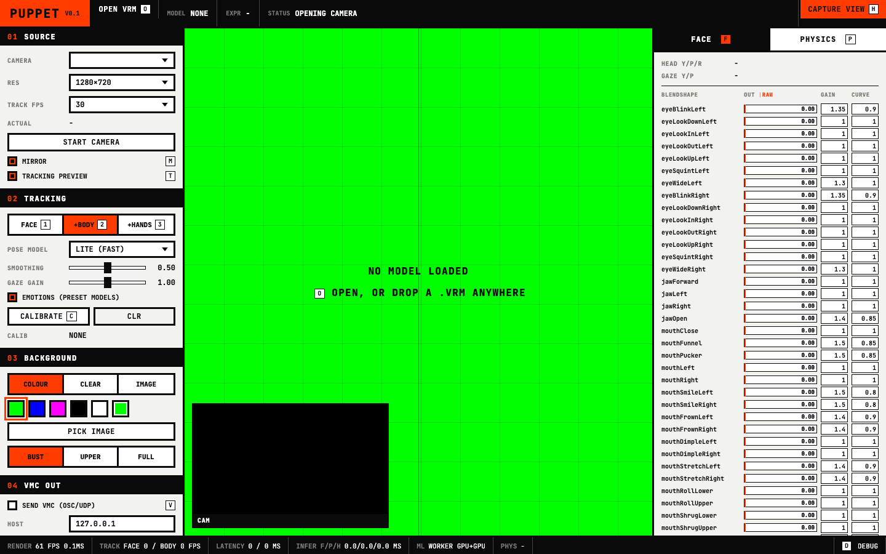

# PUPPET

Puppet is a free, open-source (MIT) webcam VTuber app. It loads a VRM avatar and drives it live from an ordinary webcam with Google MediaPipe: face (52 ARKit blendshapes, head pose, gaze), upper body and hands. It sends everything over the VMC protocol, and its spring-bone physics doesn't thrash. It is a desktop app for macOS, Windows and Linux, built with Tauri 2.



## Features

- **Face and perfect sync.** MediaPipe FaceLandmarker gives the 52 ARKit blendshapes and the head transform.
  - If the model has the ARKit-named expressions (a "perfect sync" model), each tracked value drives the expression of the same name, 1:1. Names match ignoring case and punctuation, so `eyeBlinkLeft`, `EyeBlinkLeft` and `eye_blink_left` all work.
  - Otherwise the VRM presets are derived from the blendshapes: `blink`, `blinkLeft`/`blinkRight`, `aa`/`ih`/`ou`/`ee`/`oh`, and `happy`/`angry`/`sad`/`surprised`/`relaxed` (the emotions have a dead zone and can be switched off).
  - Head rotation comes from the facial transformation matrix. Gaze from the `eyeLook*` blendshapes drives VRM lookAt (bone or expression type).
  - One-euro smoothing with a single SMOOTHING slider. Blinks and jaw keep a faster response at any setting.
  - **Calibrate** (`C`) captures your neutral face, head angle and gaze as zero.
  - Per-blendshape **gain** and **curve** (exponent) so mouths read strongly. You can edit them live next to the raw and output bars.
- **Upper body and hands.** PoseLandmarker world landmarks drive the spine, chest, shoulders and arms. HandLandmarker drives all finger bones. Choose FACE (`1`), +BODY (`2`) or +HANDS (`3`). Legs stay in an idle stance.
  - The solver is Puppet's own: direction vectors against the model's measured rest directions, with an elbow-hinge-aware upper-arm twist and part of the wrist twist moved into the forearm. Hands are found by cropping around each pose wrist, so small webcam hands are still seen. Untracked arms ease back to an idle pose.
- **VMC protocol output** over OSC/UDP from the Rust side (`rosc`). Messages: `/VMC/Ext/OK`, `/VMC/Ext/T`, `/VMC/Ext/Root/Pos`, `/VMC/Ext/Bone/Pos` (all humanoid bones, Unity coordinates), `/VMC/Ext/Blend/Val` and `/VMC/Ext/Blend/Apply`. Host and port are configurable (default `127.0.0.1:39539`). Bundles are split under 1200 bytes so they also cross a real network.
- **Stable physics.** three-vrm's spring bones with stabilisers:
  - a fixed-timestep solver (60 Hz × 1–4 substeps) decoupled from frame rate, with the accumulator clamped so a stall never replays as a burst;
  - a max tail speed per step;
  - velocity damping on collider contact (so leg colliders can't pump energy into a skirt);
  - an "inertia" share that carries tails along with the body's own motion;
  - smoothing and a speed limit on the tracked torso before physics sees it.

  There is a global OFF / STIFF / NORMAL switch (`8` `9` `0`), a per-chain table (on/off, stiffness/drag/gravity multipliers) and per-collider toggles. Overrides are saved per model, keyed by the SHA-256 of the file. See [Physics test](#physics-stability-test) for measurements.
- **App UX.**
  - Open a VRM from a file dialog (`O`) or by dropping it on the window; the last model reopens at launch.
  - Pick the camera, resolution and tracking rate.
  - Toggle the tracking preview inset (`T`) with the landmark overlay.
  - Background: solid colour (chroma key presets), transparent, or an image.
  - **Capture view** (`H`, `Esc` to leave) hides all UI for clean OBS capture.
  - A debug bar (`D`) shows render fps and frame time, face/body tracking fps, latency and inference time.
  - Settings persist to `settings.json` in the app config dir.

### Keys

`O` open · `H` capture view · `Esc` leave capture view · `C` calibrate neutral · `M` mirror · `T` preview · `V` VMC on/off · `1` `2` `3` tracking mode · `8` `9` `0` physics off/stiff/normal · `R` settle physics · `F` `P` face/physics tab · `D` debug bar

## Install, run, build

Requires Node 22+ and pnpm, Rust (stable), and the [Tauri 2 prerequisites](https://v2.tauri.app/start/prerequisites/) for your OS (Xcode command line tools on macOS; WebView2 on Windows; `libwebkit2gtk-4.1-dev` and friends on Linux).

```sh
pnpm install
pnpm tauri dev      # run the desktop app
pnpm tauri build    # release bundle: .app + .dmg on macOS, .msi/.exe on Windows, .deb/.rpm/.AppImage on Linux
pnpm test           # unit tests (blendshape mapping, one-euro filter, solver, VMC conversion)
cargo test --manifest-path src-tauri/Cargo.toml   # VMC OSC encoding + UDP loopback tests
```

`pnpm dev` alone serves the UI in a normal browser at <http://localhost:5173>. Everything except VMC output (a browser can't send UDP) and native file paths works there.

**MediaPipe models are downloaded at build time, not vendored.** `scripts/fetch-models.mjs` runs before every `dev`/`build`. It downloads the four `.task` files (Apache-2.0, published by Google) from Google's official storage (`storage.googleapis.com/mediapipe-models/...`, versioned URLs) into `public/mediapipe/models/`, checks each one against a pinned SHA-256, and copies the tasks-vision WASM runtime out of `node_modules`. The release bundle contains them. The first build needs internet access.

Builds are unsigned. On macOS, right-click the app and choose **Open** the first time, or run `xattr -dr com.apple.quarantine /Applications/Puppet.app`.

### Avatars

Puppet ships no avatar. Use your own `.vrm` (VRM 0.x or 1.0), for example one exported from [VRoid Studio](https://vroid.com/en/studio), or any model whose licence allows your use. Check the model's own VRM licence metadata. `*.vrm` is git-ignored throughout this repo; please don't commit models.

## OBS → Virtual Camera → Discord / Zoom

1. In Puppet, pick a background:
   - **COLOUR** green (`#00ff00`) is the most reliable;
   - **CLEAR** is transparent, but whether OBS keeps the alpha depends on the OS and capture method (see Known limitations).
2. Press `H` for **capture view**: only the avatar remains.
3. In OBS, add a **macOS Screen Capture** (method *Window Capture*) / **Window Capture** (Windows) / **Window Capture (Xcomposite)** (Linux) source and pick the PUPPET window.
4. For a green background, right-click the source → **Filters** → **+ Chroma Key** (key colour Green).
5. Compose your scene, then click **Start Virtual Camera** in OBS.
6. In Discord (Settings → Voice & Video → Camera) or Zoom (Settings → Video → Camera), choose **OBS Virtual Camera**.

## VMC setup

1. In Puppet's **04 VMC OUT** panel, set the receiver's host and port and tick **SEND VMC** (`V`).
   - The default `127.0.0.1:39539` is the usual VMC receive port (VSeeFace, Warudo, VNyan, VMC4U, and others).
   - For a receiver on another PC, use its LAN IP.
2. In the receiver, enable VMC/OSC receiving on that port.
   - Bones are sent as normalized-rig local rotations (identity in T-pose) in Unity coordinates, which is what receivers expect from a normalized VRM.
   - Blendshapes go out under the model's own expression names. Presets use the VRM 0.x clip names (`Blink`, `Blink_L`, `A`, `I`, `U`, `E`, `O`, `Joy`, `Angry`, `Sorrow`, `Fun`, `Surprised`), and perfect-sync models send the ARKit names. In VSeeFace, enable perfect sync on the receiving model to use them.

The TX readout shows frames and bytes sent. "Nothing listening" errors are counted, not fatal.

## Perfect sync, explained

ARKit (iPhone face tracking) defines 52 named blendshapes such as `eyeBlinkLeft`, `jawOpen` and `mouthSmileLeft`. A **perfect-sync** model ships one expression per ARKit name, sculpted by the modeller. The tracker's 52 numbers then drive the face directly, and every mouth and brow shape reads as the artist intended instead of being squeezed into five vowels and a blink. MediaPipe's FaceLandmarker outputs the same 52 names (minus `tongueOut`), so a webcam can drive a perfect-sync model without an iPhone.

Puppet detects perfect sync when the model has at least 40 of the 52 names. The header shows `PERFECT SYNC n/52` or `PRESETS n/13`. Rows the model lacks are struck through in the FACE tab.

## Testing without a camera

The app accepts URL parameters in the browser and, for the desktop app, the same parameters through the `PUPPET_QUERY` environment variable:

| parameter | effect |
|---|---|
| `source=file&src=<video>` | feed a recorded clip instead of the camera (`loop=0` to play once) |
| `model=<url or path>` | load a VRM at start |
| `mode=face\|upper\|hands`, `mirror=0\|1`, `vmc=0\|1` | override settings |
| `tracker=main` | run MediaPipe on the main thread instead of workers |
| `record=1` | keep a per-result log in `window.__puppet.record` |
| `debuglog=1` | print a stats line every 2 s (stdout in the desktop app) |

For example:

```sh
PUPPET_QUERY="source=file&src=/abs/clip.mp4&model=/abs/avatar.vrm&debuglog=1" pnpm tauri dev
```

The scripts in `scripts/` drive headless Chrome through Playwright, using your installed Google Chrome. Local assets are served by request interception, so they never need to be inside the repo.

- `PUPPET_MODEL=avatar.vrm node scripts/render-clip.mjs out/` renders test footage from a VRM. It is a scripted performance (jaw, blinks, a wink, smile, pucker, brows, head turns, arm raises) shot by a webcam-like camera, with frame-exact ground truth (`truth.json`). `PUPPET_CLEAN=1` paints out heavy face makeup, which MediaPipe misreads (black lipstick reads as a pucker).
- `PUPPET_MODEL=avatar.vrm node scripts/track-clip.mjs out/ shots/` plays that clip through the real app pipeline (`?source=file`). It reports detection rates, fps, latency and the correlation of each tracked channel with the truth, then screenshots key moments.
- `PUPPET_MODEL=avatar.vrm node scripts/physics-test.mjs` runs the physics stability test below.
- `PUPPET_MODEL=avatar.vrm node scripts/screenshot.mjs ui.png` screenshots the UI.

Footage rendered from a model inherits that model's licence. Keep it out of the repo unless the model is redistributable.

### Physics stability test

`harness/physics.ts` loads a VRM and runs a scripted sway and shake of the root for 6 s, followed by 6 s of stillness, in virtual time:

- sway: ±8 cm and ±14° at 0.6 Hz, plus 3 Hz shake;
- 30 Hz tracking-style jitter of ±6 mm and ±1.5°;
- frame time of 60 fps ±2 ms, with a 60–120 ms hitch every 0.9–1.7 s.

It measures spring-tail speed **relative to the hips** (the motion that reads as cloth or hair thrash) and the settle time until every joint stays under 0.05 m/s.

Results on a VRM 1.0 avatar with a 20-chain skirt (120 skirt joints, 223 joints in 41 chains, leg/torso colliders), 3 seeds, worst case:

| condition | max speed, all joints | p99, all | max speed, skirt | p99, skirt | settle time |
|---|---|---|---|---|---|
| three-vrm `update(frameDelta)`, raw root (no stabilisers) | 15.4 m/s | 9.8 | 7.5 | 3.6 | never (buzzes at 0.02–0.03 m/s from frame-time jitter until the end, 5.6–6.0 s) |
| fixed step + substeps only | 9.0 | 5.6 | 4.4 | 3.4 | 0.87 s |
| + speed clamp + collision damping | 7.4 | 5.4 | 4.4 | 3.3 | 0.97 s |
| **all stabilisers** (+ root smoothing, inertia 0.6) | **5.3** | **3.5** | **1.7** | **1.5** | **0.81 s** |

## Known limitations

- **Camera permission in the packaged app.**
  - macOS: the bundle carries `NSCameraUsageDescription` (`src-tauri/Info.plist`) and the camera entitlement, and the webview's media request is granted from Rust (`on_permission_request`), so you should get one OS prompt. This was verified in `tauri dev` with a video file only (no webcam was available while building this). The first-launch camera prompt of the unsigned `.app` is untested.
  - Linux: WebKitGTK media streams are switched on at startup; untested on hardware.
  - Windows: WebView2 permission is granted by the same handler; untested on hardware.
- **Transparent background.**
  - The window is created transparent (macOS uses Tauri's `macOSPrivateApi`).
  - The window content is transparent on macOS. Whether OBS keeps that alpha depends on OBS and the OS's capture API; a chroma key is the dependable route.
  - Linux transparency needs a compositor.
  - Windows is untested.
- **Hands** are the weakest tracker. Small, fast or overlapping hands drop out. On the rendered test footage, while both arms were raised, at least one hand was found in 52% of frames (26% per hand); the rendered hands are small (about 60 px) and pale. Real webcam footage was not available.
- **Single-eye winks** register weakly with MediaPipe on the test footage. Both-eye blinks track well.
- **Legs** are an idle stance only (v1). There is no hip translation or walking.
- **Pose model** changes (LITE/FULL) apply on the next launch.
- The **inertia** stabiliser assumes no VRM spring `center`; chains with a center are simulated in center space by three-vrm already.

## Licences and credits

Puppet is MIT licensed (see `LICENSE`). Third-party components and their licences are listed in [THIRD_PARTY_NOTICES.md](THIRD_PARTY_NOTICES.md).

Built on [three.js](https://threejs.org) (MIT), [@pixiv/three-vrm](https://github.com/pixiv/three-vrm) (MIT), [MediaPipe Tasks Vision](https://ai.google.dev/edge/mediapipe) (Apache-2.0, models Apache-2.0), [Tauri](https://tauri.app) (MIT/Apache-2.0), [rosc](https://github.com/klingtnet/rosc) (MIT/Apache-2.0) and [JetBrains Mono](https://www.jetbrains.com/lp/mono/) (OFL-1.1). The one-euro filter follows Casiez, Roussel and Vogel (CHI 2012).

Puppet's code is written from these libraries and their documentation. It contains no code from other VTuber applications.
